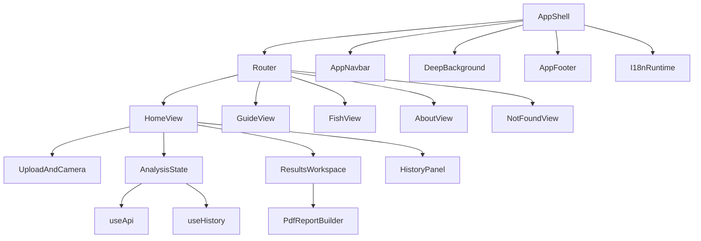

# FreshEye Vue 重写设计

状态：Vue 版本已完成迁移验收，现为唯一生产前端；Pages workflow 已切换为构建并部署 Vue 产物。

日期：2026-08-16

## 1. 目标与边界

本次工作把原生多页面 HTML/CSS/JS 前端重写为 Vue 3 + TypeScript + Vite 应用，重点解决后续功能扩展、组件复用、状态管理和双语维护成本问题。旧 `frontend/` 已删除；Vue 源码和自包含资源位于 `frontend-vue/`，构建输出为 `frontend-dist/`，不改变后端接口和模型行为。

必须保留的能力包括：上传、拖拽、剪贴板粘贴、移动端相机、示例图片、V1/V2 模型选择、健康检查、Grad-CAM 热力图、结果 Tab、置信度提示、历史记录、收藏、删除、清空、低置信度提示、PDF/HTML 报告、PWA、指南/百科/关于/404 页面、响应式布局、键盘可用性和中英文即时切换。

不在本轮改变：FastAPI 路由及字段、模型权重和推理流程、API 地址、localStorage 的既有数据语义、网站品牌主色和内容事实。GitHub Pages 的部署入口已改为 GitHub Actions 构建 `frontend-vue` 并上传 `frontend-dist`。

## 2. 当前实现事实与迁移原则

迁移前生产入口是 `frontend/`，共享逻辑主要集中在 `assets/app.js`、`assets/site.js`、CSS 分层文件以及五个 HTML 页面。迁移后的生产入口由 `frontend-vue/` 构建产生；Vue 版复用了 locale 字典、动态结果本地化、历史记录兼容和报告本地化规则，没有重新发明后端字段或第三套文案。

迁移遵循三条原则：

1. 以当前生产行为为事实源，以历史 Vue 提交作为可复用参考，不直接把历史 Vue 版本当作完成品。
2. 先抽象数据和交互契约，再拆分视图；每个拆分都要保留可回退路径。
3. 所有用户可见文案都从同一套中英文字典读取，API 原始中文只用于诊断，不直接渲染到英文界面。

## 3. 目标技术架构



技术栈保持轻量：Vue 3 Composition API、TypeScript、Vue Router 4、Vite 和自定义 CSS。除 Vue 官方生态外，不引入大型 UI 框架、运行时国际化依赖或新的后端服务。配置使用相对 base，兼容 GitHub Pages 子路径；构建产物写入根目录 `frontend-dist/`，由 Pages workflow 上传。

建议的职责边界：

| 模块 | 责任 | 不负责 |
| --- | --- | --- |
| `App.vue` | 全局壳层、滚动进度、返回顶部、全局 reveal、toast 挂载 | 具体分析业务 |
| `AppNavbar` / `AppFooter` | 导航、语言切换、品牌、页脚链接和状态 | API 请求 |
| `useApi` | `/health`、`/predict_with_gradcam`、错误归一化、响应字段兼容 | 直接操作 DOM |
| `useHistory` | 旧/新 localStorage 记录解析、排序、收藏、删除、清空 | API 请求 |
| `i18n` | locale 持久化、翻译、页面 title/meta/ARIA、语言事件 | 预测数据存储 |
| `HomeView` | 首页流程协调与页面状态 | 复写通用导航 |
| `PdfReportBuilder` | 生成当前语言的报告 HTML、标题和文件名 | 管理窗口生命周期 |
| `global.css` | 设计 token、布局、响应式、焦点、打印辅助 | 业务状态判断 |

## 4. 数据与兼容性契约

### API

Vue 版仅调用当前稳定接口：

- `GET /health`
- `POST /predict_with_gradcam?model_version=v1|v2`

响应归一化为内部类型：

```ts
type Prediction = {
  freshnessLabel: 0 | 1 | 2;
  confidenceScore: number;
  probabilityValues: [number, number, number];
  modelVersion: 'v1' | 'v2';
  timestamp?: string;
  description?: string;
  heatmapImage?: string;
};
```

`freshnessLabel` 和固定概率顺序是事实源。旧后端返回的中文 `freshness_level`、`description` 和概率对象只用于兼容解析；展示层依据当前 locale 重新生成等级、说明、建议、标签和错误文案。未知字段不得使结果页崩溃。

### localStorage

保留现有语言、模型、历史、收藏和引导状态的 key。历史解析同时支持上一轮双语升级产生的数值字段和更早的中文字段：优先读取 `freshnessLabel`，缺失时从 `freshness_level`/`freshnessLevel` 推断；概率优先读取 `probabilityValues`，缺失时按固定中文类别顺序读取旧对象。语言切换只改变渲染，不重写历史原始数据。

### 路由与静态资源

路由对应现有页面：`/`、`/guide.html`、`/fish.html`、`/about.html` 和兜底 404。Vue 页面内部采用 history fallback 兼容策略，并保留页面语义 URL 的访问兼容；发布到 Pages 前需要在构建产物中确认这些入口和静态链接不会出现死链。图片、示例、图标、manifest 和 Service Worker 继续使用已有资源，避免复制或重新压缩造成视觉差异。

## 5. UI 方向

视觉方向定为“深海观察仪 / fish-eye visual instrument”：保留深海蓝、青绿色、泡沫白和玻璃卡片的品牌基调，让布局更像一台清晰的视觉分析仪，而不是普通营销模板。

- 色彩：沿用现有 abyss/deep/sea/aqua/foam/muted 体系，只补充边框、警告和成功状态 token。
- 字体：拉丁正文优先 `Space Grotesk`/`Inter`，中文使用系统无衬线回退；品牌和少量数据指标可保留几何/等宽风格，但长段落不使用展示字体。
- 顶栏：品牌、主导航、当前页 active 状态、语言 segmented toggle 和移动菜单均为独立组件；语言按钮至少 44×44px，当前语言有高对比背景，切换后立即更新 `html.lang`、title、ARIA 和内容。
- 主内容：桌面采用稳定的分析工作区宽度，上传区和结果区在视觉层级上保持“输入—分析—证据—建议”顺序；英文长标题允许自然换行，所有 grid 子项设置 `min-width: 0`。
- 结果：保留概览、AI 依据、详细分析、建议等全部信息，热力图查看器继续支持桌面拖动/缩放和移动端触摸交互；置信度、概率和建议卡片不设会截断英文的固定高度。
- 底栏：将产品定位、导航、能力边界、赛事/开源信息和免责声明分组，避免中英文混在同一行；手机端按列堆叠并保留足够点击间距。
- 动效：保留深海背景和 reveal 的氛围，但统一由 CSS class 控制，支持 `prefers-reduced-motion: reduce`；键盘 focus-visible 必须明显。
- 响应式：至少核验 320、390、768、1024、1440px；移动端导航、语言按钮、Tab、相机弹窗、报告工具栏和热力图均不得产生意外页面横向滚动。

## 6. PDF 与报告

报告生成器与页面窗口控制分离。页面在用户点击时同步打开报告窗口，再由 `buildReportHtml()` 生成当前语言的完整 HTML；报告仍是浏览器打印/另存为 PDF，不声称生成二进制 PDF。

报告必须包含当前语言的 lang、title、工具栏、结论、置信度、概率图例、AI 依据、视觉趋势、五类建议、模型版本、时间、耗时、图片 caption、限制说明、页脚和下载文件名。中文/英文关键词标签分别由字典提供，不能通过把中文字符串替换成英文来推断风险。A4 纵向、单页目标、图片缺失兜底、移动打印和 HTML 下载行为全部回归旧版；英文内容出现多行时允许自然增高，不能靠裁切或隐藏溢出“修复”。

## 7. 验收矩阵

| 区域 | 验收重点 |
| --- | --- |
| 壳层 | 五条语义路径、导航 active、语言持久化、移动菜单、footer 链接 |
| 上传 | 点击、拖拽、粘贴、相机、示例、格式/大小/尺寸校验 |
| 分析 | health、启动/扫描阶段、V1/V2、超时/网络/400/413/422/429/503/500 |
| 结果 | 三等级、置信度三段、概率、热力图、Tab、低置信度弹窗、重新分析 |
| 历史 | 旧数据读取、收藏、删除、清空、当前语言重绘、重新打开结果 |
| 报告 | 中英文 HTML、打印入口、下载、图片缺失、A4/单页、移动工具栏 |
| 无障碍 | focus-visible、键盘、ARIA、语言通知、图片 alt、减少动效 |
| 工程 | TypeScript、构建、契约测试、旧版无改动、构建产物资源完整 |

## 8. 风险、回滚与上线策略

最大风险是把原生版中分散在 DOM 事件、CSS class 和动态文案里的隐含行为遗漏。缓解方式是以旧版行为清单、旧版双语测试、Vue 契约测试、类型检查和构建产物检查逐项迁移；旧 `frontend/` 已在 Vue 自包含构建成功后删除。

上线链路为：GitHub Actions 安装 `frontend-vue` 依赖、执行生产构建、上传 `frontend-dist` 到 Pages。若上线后出现严重回归，应回滚 Vue 迁移提交或修复 workflow/源码后重新构建；旧版 HTML 目录不再作为生产回滚入口。

## 9. 自审结论

该设计覆盖了页面、动态分析、历史、PWA 和报告能力，并把 API 与展示语言解耦。验收重点已核对旧版 localStorage key、热力图交互、报告打印等待/单页 CSS，以及旧目录删除后的独立构建。当前事实源是 `frontend-vue/`、`frontend-dist/` 和 Pages workflow；后端接口与模型文件保持独立。
